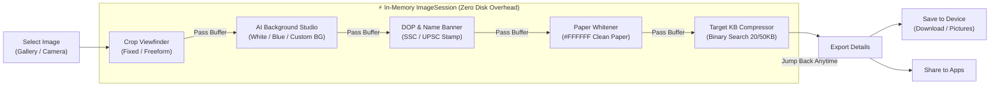

# AuraResize — Next-Gen Upgrade Architecture Plan
## AI Background Removal, Custom Color Studio & Continuous Action Pipeline

---

## 1. Executive Vision

Currently, when a user completes an operation (like Cropping), the image lands on the Export screen. If they want to compress it to 20 KB or change the background, they would previously have to save and re-import it. 

This upgrade solves two critical problems:
1. **On-Device AI Background Removal & Replacement**: Instant portrait cutout with official passport/exam color swatches (Pure White, Light Blue, Light Grey, Custom Palette, Transparent).
2. **Continuous Multi-Tool Pipeline**: An active **`ImageSession`** keeps the in-memory processed image moving seamlessly through any tool chain (*Crop $\to$ Remove BG $\to$ Stamp DOP $\to$ Compress $\to$ Save*) without manual intermediate saves.

---

## 2. Architecture & Workflow Diagram



---

## 3. Module 1: AI Background Removal & Color Studio

### 3.1. On-Device Segmentation Engine
To maintain our core promise (**100% offline, zero cloud API fees, instant speed**), we will use **Google ML Kit Selfie Segmentation** (`google_mlkit_selfie_segmentation`):
- **Model Size**: ~3.2 MB on-device.
- **Processing Time**: < 120ms on mid-range Android devices.
- **Accuracy**: Generates a high-precision alpha mask $(0.0 - 1.0)$ distinguishing hair, face, neck, and shoulders from background.

### 3.2. Color Replacer & Edge Feathering
A raw cutout often has rough hair pixels. Our custom pixel blender will apply a 1.5px Gaussian edge feathering:
$$\text{Pixel}_{\text{final}} = \alpha \cdot \text{Foreground} + (1 - \alpha) \cdot \text{Background}_{\text{selected}}$$

### 3.3. Official Portal Background Presets
| Preset Name | Color Hex | Primary Use Case |
| :--- | :--- | :--- |
| **Pure White** | `#FFFFFF` | SSC, UPSC, US Visa, NTA NEET, PAN Card |
| **Passport Blue** | `#93C5FD` / `#60A5FA` | Indian Passport, Schengen Visa, Corporate Badges |
| **Studio Off-White** | `#F8FAFC` | Bank PO, State PSCs |
| **Transparent** | `Alpha 0` | Digital Signatures, Web Profiles, Stamps |
| **Custom Swatch** | Hex / Palette | Any custom color required by user |

---

## 4. Module 2: Continuous Multi-Tool Action Pipeline

### 4.1. The `ImageSession` State Model
Instead of passing file paths back and forth, a lightweight session state will manage the working image in memory:

```dart
class ImageSession {
  Uint8List currentBytes;
  int width;
  int height;
  String currentFormat; // 'JPG', 'PNG', 'PDF'
  int? targetKb;
  
  // Undo / Redo history stack
  final List<Uint8List> history = [];
  
  void applyStep(Uint8List newBytes) {
    history.add(currentBytes);
    currentBytes = newBytes;
  }
}
```

### 4.2. "Next Action" Action Bar
At the bottom of every tool screen (and on the Export Details screen), a sleek horizontal **Action Ribbon** will allow 1-tap jumps:

```
[ ➔ Remove BG ]   [ ➔ Target KB ]   [ ➔ Add DOP Banner ]   [ ➔ Change Format ]
```

- Tapping any pill automatically takes the current buffer and opens the selected tool immediately.
- Zero file export, zero gallery picking, zero duplicate files.

---

## 5. Screen-by-Screen Implementation Plan

### Screen 1: `BackgroundStudioScreen` (New)
1. **Interactive Preview**: Shows before/after toggle.
2. **Color Palette Selector**:
   - Quick pills: `White`, `Light Blue`, `Off-White`, `Dark Blue`, `Transparent`.
   - Custom Color Wheel dialog.
3. **Smooth Edge Slider**: Fine-tune hair boundary smoothness (0 to 5px).
4. **Bottom Bar**: `[ Save ]` or `[ ➔ Compress ]` or `[ ➔ Crop ]`.

### Screen 2: Updated `SarkariCropStudioScreen`
- In addition to the "Export" button in AppBar, add an **"Actions" menu / pill row**:
  - `[ BG Color ]` $\to$ opens Background Studio with cropped image.
  - `[ Target KB ]` $\to$ opens Compressor with cropped image.

### Screen 3: Updated `SarkariResultScreen`
- Add a **"Continue Editing"** section below the preview:
  - 1-tap shortcuts to refine the same image in any tool without leaving the session.

---

## 6. Implementation Milestones for Tomorrow

| Step | Task | Deliverable |
| :---: | :--- | :--- |
| **1** | Add `google_mlkit_selfie_segmentation` to `pubspec.yaml` | Android ML segmentation bindings |
| **2** | Create `BackgroundRemovalEngine` in `services/` | Alpha mask extraction & background color blending |
| **3** | Build `BackgroundStudioScreen` in `ui/views/background/` | Color swatches, custom picker & live preview |
| **4** | Implement `ImageSession` & Chained Action Ribbon | Direct tool-to-tool navigation without re-import |
| **5** | Integrate into `AuraResize` Home & Result screens | Complete unified workflow |
| **6** | Build & Test Android Release APK | `AuraResize-Release.apk` |

---
> [!NOTE]
> ML Kit Selfie Segmentation runs completely on-device without internet access, ensuring candidate privacy and zero network latency.
